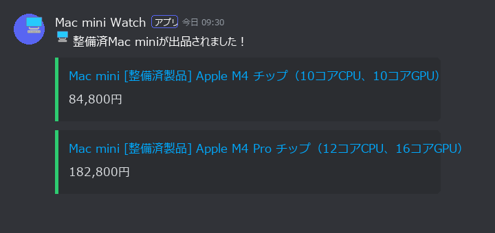

# mac-mini-refurb-watch

Apple公式の[整備済製品ページ](https://www.apple.com/jp/shop/refurbished/mac)を5分ごとにチェックして、以下が出品されたら**Discordに通知**します。

共通条件は **M5以降**（M5 Pro/Max・M6以降も含む）です。メモリ・画面サイズが読めない商品は通知しません。互いに重ならない5つの条件で見ているので、1つの出品が2回通知されることはありません。

1. ⭐ **【本命】13インチMacBook Air・メモリ32GB・SSD 1TB・USキーボード**
2. ⭐ **【本命】13インチMacBook Air・メモリ32GB・SSD 1TB・JISキーボード**
3. 13インチMacBook Air・**メモリ24GB以上**・USキーボード（本命の32GB/1TBは1・2で通知するので除く。SSDは不問）
4. 14インチMacBook Pro・USキーボード（メモリ不問）
5. 14インチMacBook Pro・**メモリ24GB以上**・JISキーボード

通知しないもの: JISのAirで本命以外（24GBなど）、JISのProで24GB未満、15インチAir、16インチPro、M4以前、Mac mini。

※ 購入する構成は13インチAir・32GB・1TB（本命）に決めていますが、2026-11-23に「本命より少し条件の低いものも知りたい」との希望で、近い構成（24GB以上のUS配列Air・14インチPro）も通知するようにしました。本命は見出しに⭐【本命】が付きます。メモリ・SSDの「ちょうど一致」は本命だけで、24GBの下限は `check.py` の `MIN_MEMORY_GB` です。

※ リポジトリ名の由来であるMac mini監視は、M6搭載の新型発売に伴い2026-08-26に停止しました（復活させる場合はgit履歴参照）。

GitHub Actionsで動くので、サーバー不要・完全無料です。


*（通知イメージ）*

## 仕組み

```
GitHub Actions（外部サーバーのcronから5分ごとに起動。GitHub側のcronは保険）
  └─ check.py
       ├─ Appleの整備済製品ページ（MacBook Air・MacBook Pro）を取得
       ├─ 埋め込みJSON (REFURB_GRID_BOOTSTRAP) から監視対象を抽出
       │    └─ ウォッチごとに機種・サイズ・M5以降・メモリ・SSDで絞り、条件に合うものだけ
       │       タイル情報または商品詳細ページで配列を判定（US/JIS）
       ├─ state.json（前回の出品リスト・キーボード判定キャッシュ）と比較
       ├─ 新着があれば Discord Webhook に通知
       └─ state.json を更新してリポジトリにコミット
```

依存ライブラリなし（Python標準ライブラリのみ）。

## セットアップ

### 1. Discord Webhookを作る

通知を受け取りたいDiscordチャンネルで：
**チャンネル設定（⚙️）→ 連携サービス → ウェブフック → 新しいウェブフック → URLをコピー**

### 2. GitHubリポジトリを作ってプッシュ

```sh
gh repo create mac-mini-refurb-watch --private --source . --push
```

### 3. Webhook URLをSecretに登録

```sh
gh secret set DISCORD_WEBHOOK_URL --body "https://discord.com/api/webhooks/..."
```

（またはリポジトリの Settings → Secrets and variables → Actions から `DISCORD_WEBHOOK_URL` を登録）

### 4. 動作確認

Actionsタブ → **Check refurbished MacBook Air 13 / Pro 14 (M5+)** → **Run workflow** で手動実行。
ログに `MacBook Air 本命 (USキーボード): tiles: NNN, hit: N, new: N` のような行が監視対象ごとに出れば動いています。

## ローカルでの動作確認

```sh
python check.py                 # DISCORD_WEBHOOK_URL 未設定ならドライラン（通知内容をprintするだけ）
```

## 注意

- GitHub Actionsのcron（`schedule`）はGitHub側で大きく間引かれます。`*/5` の設定でも、2026年11月時点の実績は1日4回ほどでした。
- そのため、外部サーバーのcronから5分ごとに `workflow_dispatch`（手動起動のAPI）を叩いて起動しています。手動起動は間引かれません。
  - 叩くAPI: `POST /repos/<owner>/<repo>/actions/workflows/check.yml/dispatches`（本文 `{"ref":"main"}`）
  - 必要な権限: このリポジトリだけを対象にした fine-grained トークンの「Actions: Read and write」
  - 外部サーバーが止まっても、GitHub側のcronが保険として（間引かれながら）動き続けます。
- **リポジトリに60日間コミットがないと、GitHubがスケジュール実行を自動停止します**（メールが来るのでActionsタブから再有効化すればOK）。在庫変動があるたびに `state.json` がコミットされるので、実際にはほぼ止まりません。
- 監視対象を増やしたい場合は `check.py` の `WATCHES` に `model`・`url`・`specs`（タイルのスペック条件）・`matches`（キーボード配列の判定関数）・`header` を指定したエントリを追加してください。`model` はAppleの `refurbClearModel` に対応します。
- 各ウォッチは、先に `specs` でスペックを絞ってから配列判定に進みます。スペックに合わない商品では商品詳細ページを取得しません。条件の値は `check.py` の `TARGET_MEMORY_GB`（本命の32GB）・`TARGET_STORAGE`（本命の1TB）・`MIN_MEMORY_GB`（24GB以上の下限）です。一覧データに画面サイズが無い商品は全ウォッチで、メモリが無い商品はメモリ条件のあるウォッチで、通知しません（Proの「メモリ不問」の条件はメモリ不明でも通知します）。価格による制限はありません。
- MacBook Air・Proとも、まず一覧タイル内のUS/JIS表記を確認し、判定できない場合だけ商品詳細ページを取得します。通知の見出しに機種・条件・配列を表示します。13インチは13.3/13.6インチ、14インチは14.2インチ表記を含みます。
- 通知は1出品ごとに、タイトル（クリックで商品ページへ）に「画面サイズ・機種｜チップ（CPU/GPUコア数）｜メモリ｜SSD｜キーボード配列｜カラー」を並べ、価格・チップ・メモリ（Apple シリコンはGPUと共用＝VRAM相当）・ストレージ・配列・カラーを項目でも表示します。M5／M5 Pro／M5 Maxやコア数違いも開かずに見分けられます。仕様は一覧ページのデータから取り、取れない項目は「不明」と表示します。
- キーボード配列はpartNumberごとに `us` / `jis` として保存します。不明・取得失敗・US/JIS両方の表記がある商品は通知せず、次回実行で再試行します。旧形式の `true` はUSとして引き継ぎ、`false`（非US）はJISと断定せず再判定します。
- 条件を変えた後の初回実行では、前回の記録（`state.json`）に残っていた条件外の出品（JISの24GB Air・16GB未満のAir・16インチProなど）は通知なしで記録から消えます。以後は条件に合う出品の追加・再入荷時に通知します。
- 通知周期はGitHub Actionsのcron（`.github/workflows/check.yml`）で5分に設定しています。publicリポジトリなのでActionsは無料・無制限です（Privateに戻す場合は無料枠の都合で30分以上に戻すこと）。
